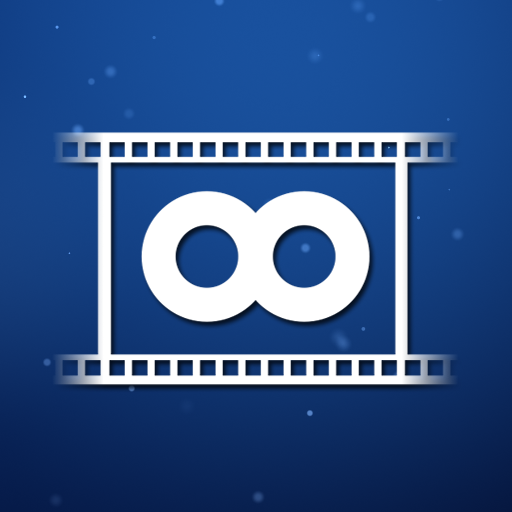
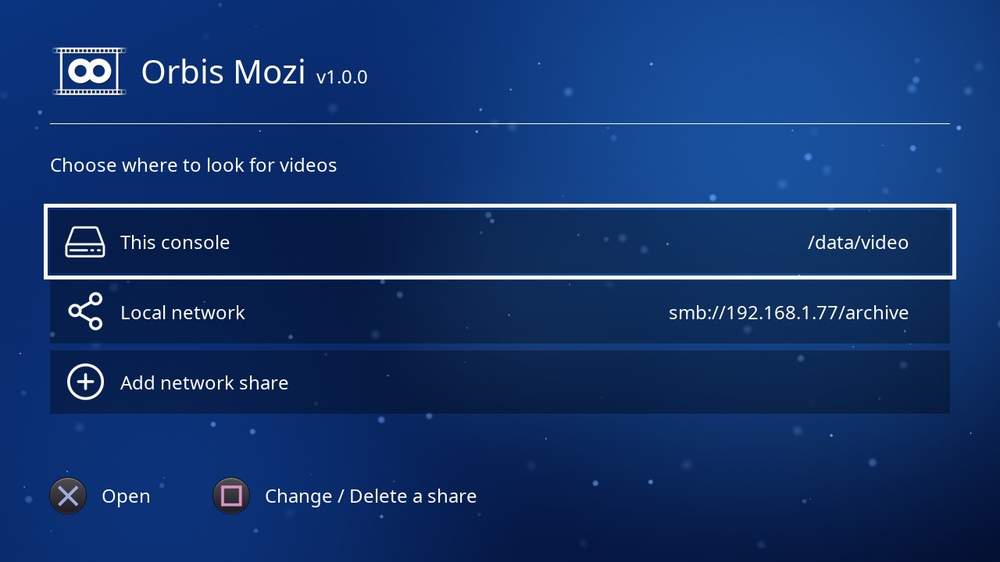
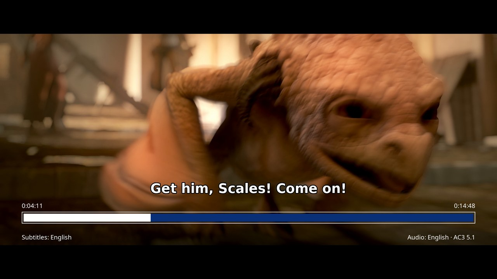
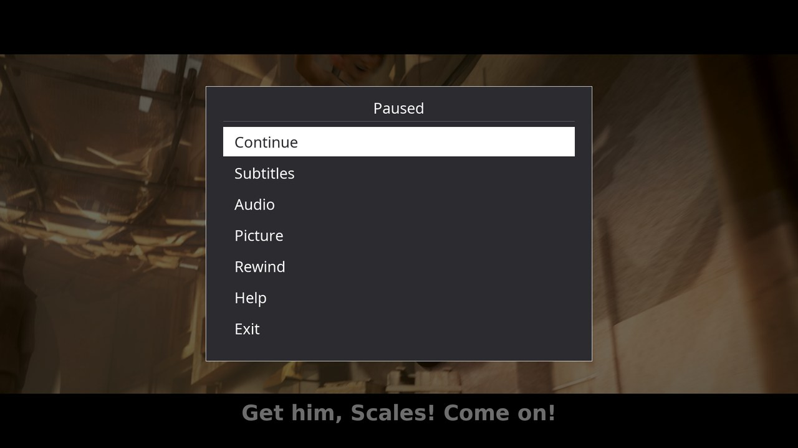
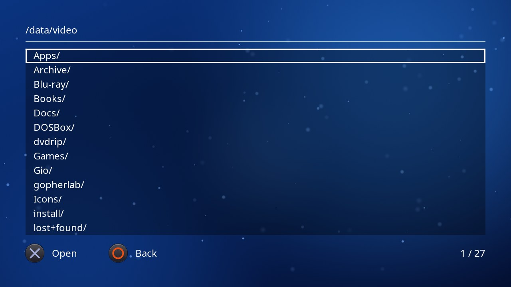
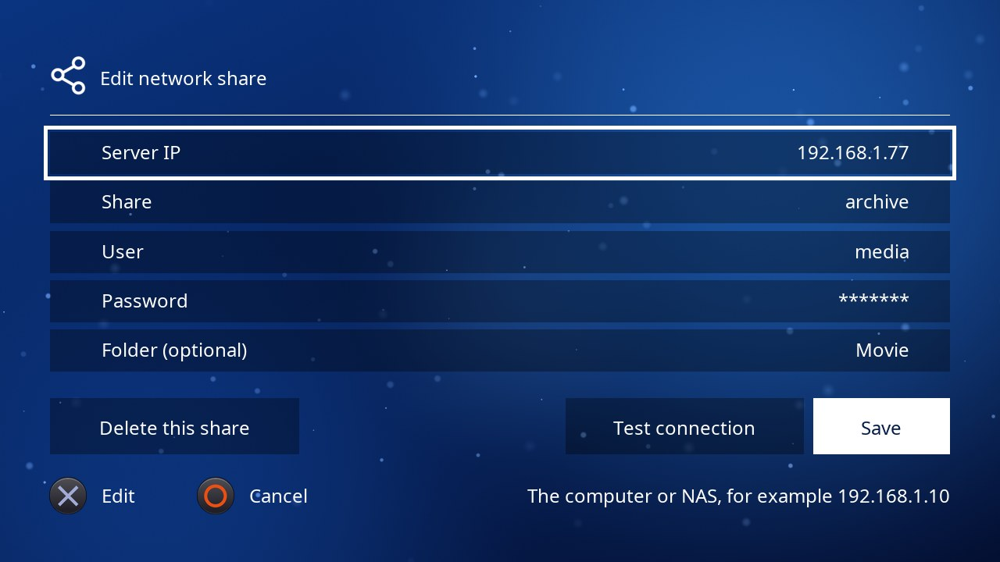

<p align="center">
  
</p>

<h1 align="center">Orbis Mozi</h1>

<p align="center">A video player for the PlayStation 4 that plays the files the built-in Media
Player refuses: MKV and other containers, decoded with FFmpeg.</p>

<p align="center">
  
  
  
  
  
</p>

<p align="center">
  <br>
  <em>Main menu</em>
</p>

<table>
  <tr>
    <td align="center"><br><em>Overlay while playing</em></td>
    <td align="center"><br><em>Pause menu</em></td>
  </tr>
  <tr>
    <td align="center"><br><em>File list</em></td>
    <td align="center"><br><em>Network share form</em></td>
  </tr>
</table>

<p align="center"><sub>The film in the screenshots is <em>Sintel</em>, © Blender Foundation | durian.blender.org, CC BY 3.0.</sub></p>

Orbis Mozi plays your own video files on a PlayStation 4: from the console's
disk, or straight from a shared folder on your home network. It needs a
console that can run homebrew packages, for example with GoldHEN.

*Mozi* is Hungarian for cinema; *Orbis* is the PS4's codename.

## What it does

- **Plays what the built-in Media Player refuses:** MKV, MP4, AVI, WebM, FLV
  and more, with H.264, H.265, MPEG-4 (Xvid, DivX), MPEG-2, VP8 and VP9 video.
- **Network shares:** plays directly from a Windows or Samba share (SMB2/SMB3),
  with nothing to copy.
- **Subtitles and audio tracks:** text subtitles inside the file (SRT, ASS)
  with accented letters, picture subtitles (Blu-ray, DVD), an `.srt` file
  with the video's name beside it, and a choice between the file's audio
  tracks.
- **The usual controls:** pause, jumps of 10 seconds and 10 minutes, and
  volume up to 200%.

The full list of tested formats is in [What plays](docs/formats.md).

## Install

1. Download the newest `OrbisMozi-x.y.z.pkg` from the
   [releases](https://github.com/goph-R/OrbisMozi/releases/latest).
2. Copy it to the console (USB drive or FTP) and install it with your package
   installer. With GoldHEN: *Settings → Debug Settings → Game → Package Installer*.
3. Start *Orbis Mozi* from the home screen.

## Getting videos to play

Either way works, and you can use both.

### From a network share

1. In the main menu choose **Add network share**.
2. Fill in the server's IP address, the share's name, and the user and password
   if the share needs a login.
3. **Test connection** tells you whether it works. Then **Save**.

The share appears in the main menu as *Local network*. Square on it lets you
change or delete it.

The server has to offer SMB2 or SMB3; the old SMB1 alone is not enough. The
password is stored on the console as plain text.

### From the console's disk

Copy videos into `/data/video` on the console, for example with GoldHEN's FTP
server (port 2121). Subfolders are fine. They appear under *This console*.

```sh
curl -T film.mkv ftp://<ps4-ip>:2121/data/video/
```

USB drives cannot be read: a PS4 application is not allowed to see them.

## Controls

| Button | In the menu | While playing |
|---|---|---|
| D-pad up/down | move | volume up / down |
| D-pad left/right | page up / down | 10 seconds back / forward (hold to keep going) |
| L1 / R1 | page up / down | 10 minutes back / forward |
| Cross | open folder / play | show the overlay |
| Circle | back | pause and open the menu (continue, subtitles, audio, picture, rewind, help, exit) |
| Square | change or delete a share | next audio track |
| OPTIONS | | next subtitle track, then off |
| Triangle | | show / hide the diagnostics line |
| PS | | quit |

## Good to know

- **Tested on a PS4 Pro, and reported working on a base PS4** (a 1080p H.264
  film from a Samba share, no dropped frames). Reports from other models are
  welcome.
- 4K and heavy H.265 files are not expected to play smoothly.
- Surround sound is mixed down to stereo.

**If something does not work**, the app writes a log to
`/data/orbismozi/log.txt` on every start. Attach it when you
[report a problem](https://github.com/goph-R/OrbisMozi/issues).

## More

| | |
|---|---|
| [What plays](docs/formats.md) | every tested video, audio and subtitle format, and the limits |
| [Changelog](CHANGELOG.md) | what changed in each version |
| [Roadmap](docs/roadmap.md) | what is missing and what may come |
| [Building](docs/building.md) | building the package yourself, and testing on a PC |
| [How it works](docs/how-it-works.md) | the source files, the threads, the design sources |
| [Licences and credits](docs/licences.md) | FFmpeg, libsmb2, fonts and the rest |

## Licence

Orbis Mozi is released under the [MIT licence](LICENSE). It contains FFmpeg
and libsmb2 (both LGPL 2.1 or later) and is built with the OpenOrbis toolchain;
the details are in [Licences and credits](docs/licences.md).

This project is not affiliated with or endorsed by Sony Interactive
Entertainment. "PlayStation" and "PS4" are trademarks of their owner. Use it
with files you have the right to play.
