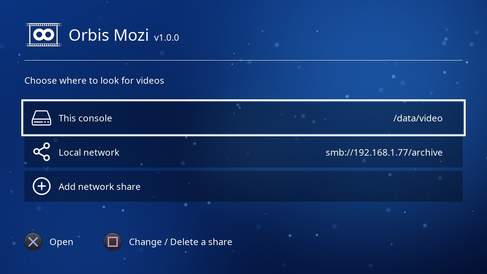

# Orbis Mozi 0.1.0

The first public release of Orbis Mozi, a video player for the PlayStation 4
that plays the files the built-in Media Player refuses: MKV and other
containers, decoded with FFmpeg. It needs a console that can run fake-signed
packages, for example with GoldHEN.

## What it does

- Plays videos from the console's disk and straight from a network share
  (SMB2/SMB3, for example Windows or Samba).
- Video: H.264 and H.265 (8 and 10 bit), MPEG-4 (Xvid, DivX), MPEG-2, VP8,
  VP9.
- Audio: AAC, AC3, E-AC3, DTS, FLAC, MP3, MP2, Opus, Vorbis.
- Containers: MKV, MP4, AVI, FLV, WebM, MPEG-PS, MPEG-TS.
- Text subtitles inside the file (SRT, ASS/SSA), with accented letters, and a
  choice of audio track.
- Pause, jumps of 10 seconds and 10 minutes, and volume from 0 to 200%.

The full list of tested formats is in the
[README](https://github.com/goph-R/OrbisMozi/blob/v0.1.0/README.md#tested-codecs).

## Install

1. Download `OrbisMozi-0.1.0.pkg` below and copy it to the console (USB drive
   or FTP).
2. Install it with your package installer (GoldHEN: *Package Installer*).
3. Start *Orbis Mozi*, then either copy videos to `/data/video` on the
   console, or choose *Add network share* in the menu.

## Controls

| Button | In the list | While playing |
|---|---|---|
| D-pad up/down | move | volume up / down |
| D-pad left/right | page up / down | 10 seconds back / forward |
| L1 / R1 | page up / down | 10 minutes back / forward |
| Cross | open folder / play | pause, continue |
| Circle | back | stop, return to the list |
| Square | change or delete a share | next audio track |
| OPTIONS | | next subtitle track, then off |
| Triangle | | show / hide the diagnostics line |

## Known limitations

- Tested on a PS4 Pro only. Reports from other models are welcome.
- Decoding is done on the CPU: 4K and heavy H.265 files are not expected to
  play smoothly.
- No picture-based subtitles (Blu-ray PGS, DVD) and no separate `.srt` files
  yet.
- Multichannel audio is mixed down to stereo.
- USB drives cannot be read by the app; videos go to `/data/video` or come
  from a network share.
- The password of a network share is stored on the console as plain text.

If something does not work, the log at `/data/orbismozi/log.txt` is the thing
to attach to a bug report.

## Licence

Orbis Mozi is released under the MIT licence. The package contains FFmpeg and
libsmb2, both under the LGPL 2.1 or later; the sources and build scripts in
this repository are what lets you rebuild them.
