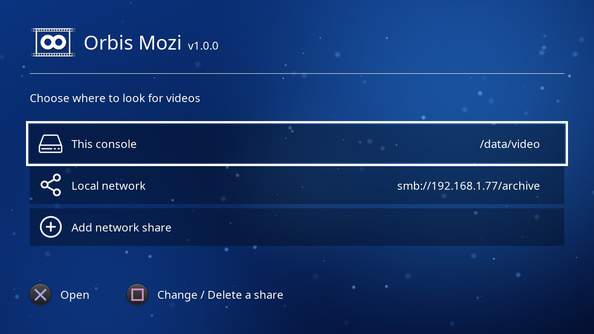
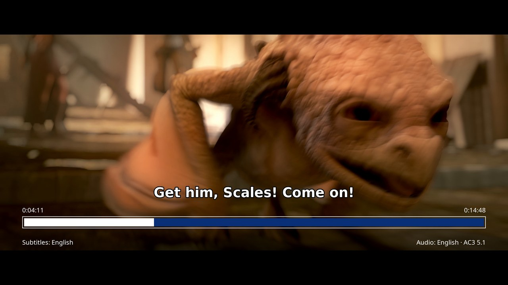
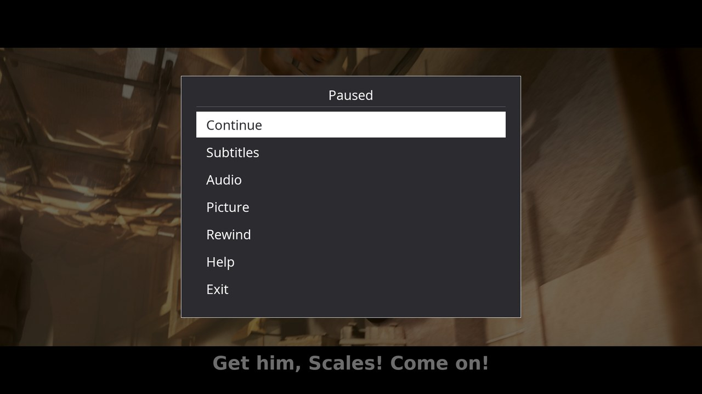
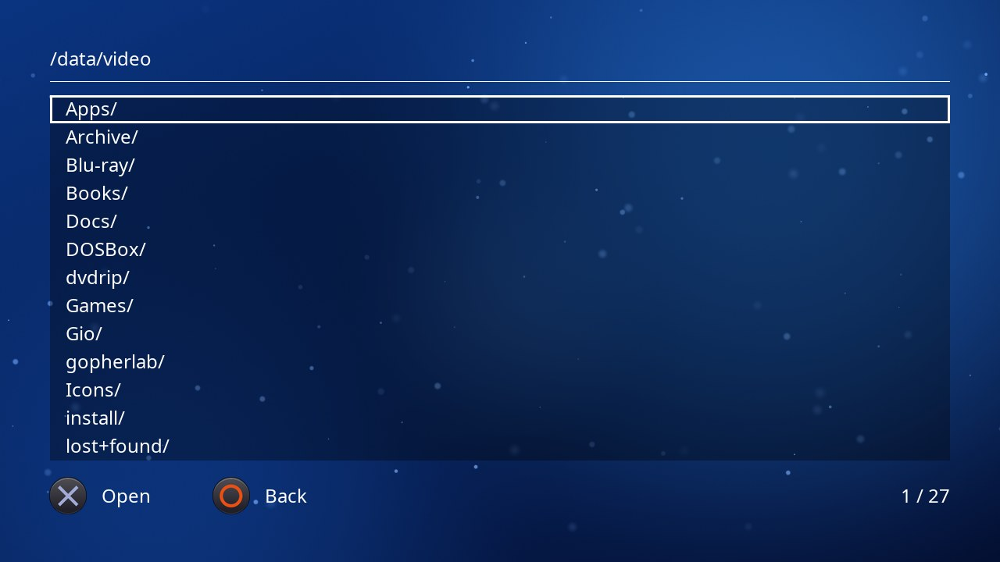
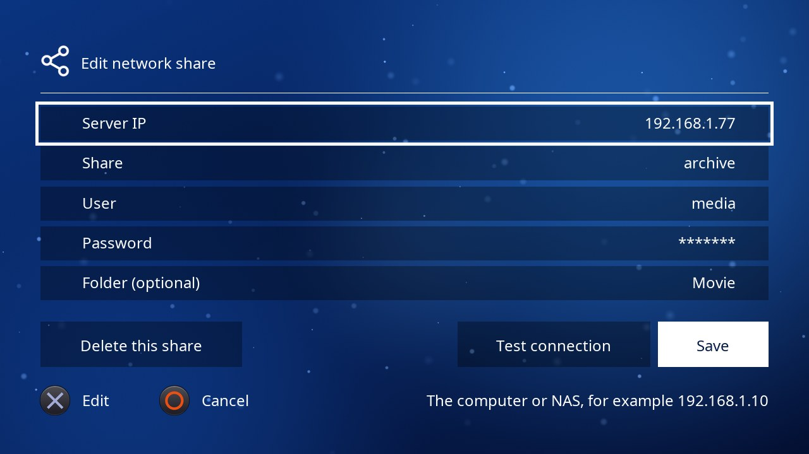

# Orbis Mozi 1.0.0

Orbis Mozi is a video player for the PlayStation 4 that plays the files the
built-in Media Player refuses: MKV and other containers, decoded with FFmpeg.
It needs a console that can run fake-signed packages, for example with
GoldHEN.

| | |
|---|---|
|  |  |
|  |  |

The film in the screenshots is *Sintel*, © Blender Foundation |
durian.blender.org, CC BY 3.0.

## New since 0.1.0

- **Pause menu:** Circle pauses and opens a menu over the picture: continue,
  subtitles, audio, picture, rewind, help, exit.
- **Overlay:** any button shows the position, the subtitle and the audio
  track in use.
- **Subtitle files:** an `.srt` file beside the video with the same name is
  loaded and switched on (UTF-8, UTF-16, Windows-1250).
- **Picture subtitles:** Blu-ray (PGS), DVD and DVB subtitles inside the file
  are listed and shown.
- **Continue:** the video played last continues where it was left.
- **Picture modes:** fit, fill (no borders, edges cut off) and stretch.
- Reported working on a base PS4: a 1080p H.264 film from a Samba share with
  no dropped frames.

The full list of tested formats is in
[What plays](https://github.com/goph-R/OrbisMozi/blob/v1.0.0/docs/formats.md).

## Install

1. Download `OrbisMozi-1.0.0.pkg` below and copy it to the console (USB drive
   or FTP).
2. Install it with your package installer (GoldHEN: *Package Installer*).
3. Start *Orbis Mozi*, then either copy videos to `/data/video` on the
   console, or choose *Add network share* in the menu.

## Controls

| Button | In the list | While playing |
|---|---|---|
| D-pad up/down | move | volume up / down |
| D-pad left/right | page up / down | 10 seconds back / forward |
| L1 / R1 | page up / down | 10 minutes back / forward |
| Cross | open folder / play | show the overlay |
| Circle | back | pause and open the menu |
| Square | change or delete a share | next audio track |
| OPTIONS | | next subtitle track, then off |
| Triangle | | show / hide the diagnostics line |

## Known limitations

- Decoding is done on the CPU: 4K and heavy H.265 files are not expected to
  play smoothly.
- Picture subtitles were tested with sample files only; reports with real
  films are welcome.
- Subtitle files other than `.srt` are not read.
- Multichannel audio is mixed down to stereo.
- USB drives cannot be read by the app; videos go to `/data/video` or come
  from a network share.
- The password of a network share is stored on the console as plain text.

If something does not work, the log at `/data/orbismozi/log.txt` is the thing
to attach to a bug report.

## Licence

Orbis Mozi is released under the MIT licence. The package contains FFmpeg and
libsmb2, both under the LGPL 2.1 or later; the sources and build scripts in
this repository are what lets you rebuild them.
